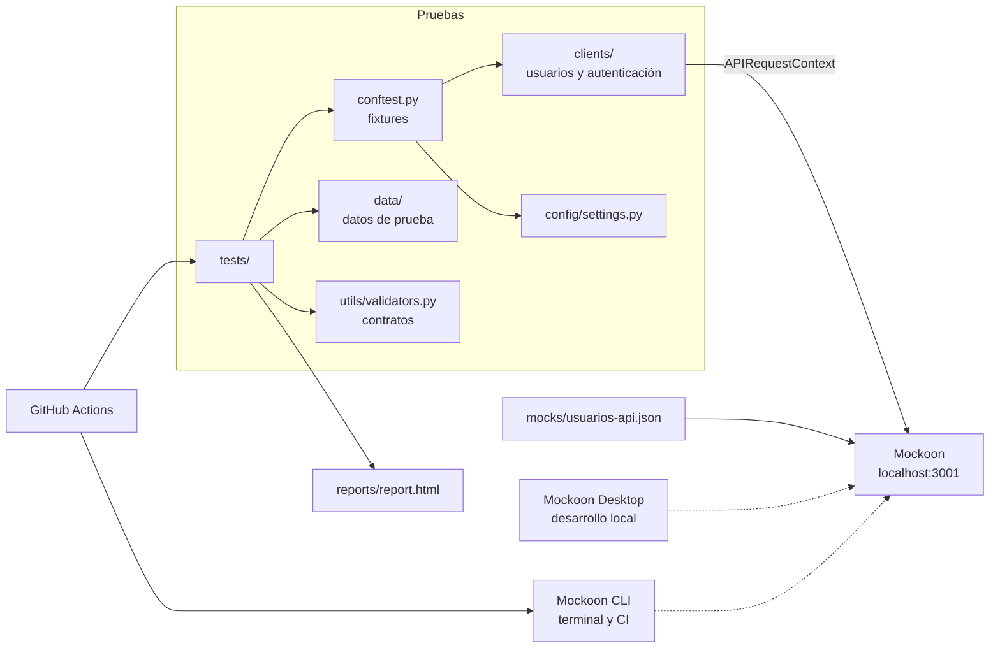

# POC API REST con Playwright, Pytest y Mockoon

[](https://github.com/RicardoPavezCatrileo/poc_api_rest_playwright_mockoon/actions/workflows/api-tests.yml)

Prueba de concepto educativa de automatización de pruebas de API REST. Usa `APIRequestContext` de Playwright para Python, sin navegador, contra una API de usuarios simulada con Mockoon. Los cambios se guardan en memoria mediante data buckets.

Todas las credenciales, tokens y API Keys de este repositorio son ficticios y exclusivamente de laboratorio.

## Objetivos

- Automatizar pruebas de servicios REST con clientes reutilizables, fixtures y parametrización.
- Validar flujos CRUD, autenticación, autorización, errores HTTP, timeouts y contratos de respuesta.
- Distinguir un timeout del cliente de una respuesta HTTP 504 o 524.
- Ejecutar la misma suite en local, con Mockoon Desktop, y en GitHub Actions, con Mockoon CLI.
- Documentar una estrategia de ramas para trabajar en equipo.

## Arquitectura



```text
.github/workflows/api-tests.yml   Workflow de CI
.github/pull_request_template.md  Plantilla de pull request
.vscode/settings.json             Intérprete y detección de pruebas
clients/                          Clientes REST de usuarios y autenticación
config/settings.py                URL base, timeouts y umbrales
data/                             Datos de prueba
docs/branching-strategy.md        Estrategia de ramas
mocks/usuarios-api.json           Entorno de Mockoon
reports/                          Reportes generados (no se versionan)
tests/                            Casos de prueba y fixtures
utils/validators.py               Validaciones de contrato
```

`data/` no estaba en la estructura inicial: se agregó para separar los datos de los casos de prueba.

## Tecnologías

| Herramienta | Uso | Versión |
|---|---|---|
| Python | Lenguaje | 3.12 o superior; probado con 3.13 |
| Playwright para Python | Solicitudes HTTP con `APIRequestContext` | 1.64.1 |
| Pytest | Framework de pruebas | 9.2.0 |
| pytest-html | Reporte HTML | 4.2.0 |
| pytest-cov | Cobertura del código Python | 7.1.0 |
| python-dotenv | Variables de entorno | 1.2.4 |
| Mockoon Desktop | Mock local con visualización de solicitudes | Probado con 9.10.0 |
| Mockoon CLI | Mock en terminal y CI | 9.10.0 |
| GitHub Actions | Integración continua | — |

No hace falta ejecutar `playwright install`: `APIRequestContext` no usa navegadores.

## Instalación

Requisitos: Windows 11 con PowerShell, Python 3.12 o superior, Node.js 18 o superior y Mockoon Desktop.

```powershell
python -m venv .venv
.\.venv\Scripts\Activate.ps1
python -m pip install -r requirements.txt
```

Si PowerShell bloquea la activación, ejecute antes:

```powershell
Set-ExecutionPolicy -Scope Process -ExecutionPolicy RemoteSigned
```

## Configuración

Los valores por defecto sirven sin cambios. Para modificarlos:

```powershell
Copy-Item .env.example .env
```

| Variable | Por defecto | Uso |
|---|---|---|
| `API_BASE_URL` | `http://localhost:3001` | URL de la API |
| `API_TIMEOUT_MS` | `20000` | Timeout general y timeout suficiente |
| `API_SHORT_TIMEOUT_MS` | `5000` | Timeout corto del cliente |
| `SLOW_ENDPOINT_DELAY_MS` | `15000` | Retardo esperado de `/api/usuarios/lento` |
| `MAX_RESPONSE_TIME_MS` | `2000` | Umbral de tiempo de respuesta |

### Visual Studio Code

1. Abra la carpeta del proyecto.
2. Con `Ctrl+Shift+P`, elija **Python: Select Interpreter** y seleccione `.venv`.
3. Abra la vista **Testing**: la detección de Pytest ya está configurada sobre `tests/`.
4. Para depurar, ponga un punto de interrupción y use **Debug Test** con Mockoon en marcha.

No agregue `--cov` a `python.testing.pytestArgs`, porque interfiere con los puntos de interrupción.

## Endpoints

| Método | Endpoint | HTTP | Notas |
|---|---|---|---|
| GET | `/api/health` | 200 | Estado del servicio |
| GET | `/api/usuarios` | 200 | Usuarios actuales |
| GET | `/api/usuarios/{id}` | 200, 404 | |
| GET | `/api/usuarios/999` | 404 | Ruta estática |
| GET | `/api/usuarios/lento` | 200 | Retardo de 15 s |
| POST | `/api/usuarios` | 201, 400, 422 | Requiere los cuatro campos; el id se genera solo |
| PUT | `/api/usuarios/{id}` | 200, 400, 404, 422 | Requiere los cuatro campos y reemplaza el usuario |
| PATCH | `/api/usuarios/{id}` | 200, 400, 404, 422 | Acepta solo los campos que cambian |
| DELETE | `/api/usuarios/{id}` | 204, 404 | Sin cuerpo ni `Content-Type` |
| POST | `/api/auth/login` | 200, 401 | Entrega un token Bearer |
| GET | `/api/secure/usuarios` | 200, 401, 403 | Requiere token Bearer |
| GET | `/api/apikey/usuarios` | 200, 401 | Requiere `X-API-Key` |
| GET | `/api/errores/{codigo}` | El indicado | 400, 401, 403, 404, 409, 422, 429, 500, 502, 503, 504 y 524 |
| POST | `/api/test/reset` | 200 | Solo para laboratorio: restablece los usuarios |

Ejemplo de cuerpo para POST y PUT:

```json
{
  "nombre": "Ana Torres",
  "email": "ana.torres@example.com",
  "rol": "admin",
  "activo": true
}
```

`rol` admite `admin`, `supervisor` o `usuario`, y no se aceptan otros campos, incluido `id`.

Mockoon evalúa las rutas en orden: `lento`, `999` y DELETE deben permanecer antes de la ruta CRUD `/api/usuarios`.

### Persistencia

El CRUD no es una base de datos real. Los usuarios viven en memoria, en el data bucket `usuarios`: los cambios se ven en las solicitudes siguientes y se pierden al reiniciar Mockoon o al llamar a `POST /api/test/reset`.

Pytest restablece los datos antes de cada prueba, así que ejecutar la suite borra los cambios hechos a mano.

## Autenticación

### Bearer Token

| Usuario | Contraseña | Token | Resultado en `/api/secure/usuarios` |
|---|---|---|---|
| `qa_user` | `demo123` | `token-demo-12345` | 200 |
| `qa_sin_permisos` | `demo123` | `token-sin-permisos-67890` | 403 |

```powershell
$cuerpo = @{ username = "qa_user"; password = "demo123" } | ConvertTo-Json
$login = Invoke-RestMethod -Method Post http://localhost:3001/api/auth/login -ContentType "application/json" -Body $cuerpo
Invoke-RestMethod http://localhost:3001/api/secure/usuarios -Headers @{ Authorization = "Bearer $($login.access_token)" }
```

Los tokens son cadenas fijas: no son JWT y no tienen firma ni expiración.

| Código | Significado | Casos |
|---|---|---|
| 401 | No se sabe quién llama. Incluye `WWW-Authenticate: Bearer` | Token ausente, incorrecto o con formato inválido |
| 403 | Se sabe quién llama, pero no tiene permisos | Token válido de `qa_sin_permisos` |

`qa_sin_permisos` no estaba en la especificación inicial: se agregó para obtener un token válido sin permisos.

### API Key

```powershell
Invoke-RestMethod http://localhost:3001/api/apikey/usuarios -Headers @{ "X-API-Key" = "demo-api-key-123" }
```

Una API Key incorrecta, ausente o vacía recibe 401.

## Pruebas

| Archivo | Positivas | Negativas |
|---|---|---|
| `test_get_usuarios.py` | Lista y usuario existente | Usuario inexistente |
| `test_post_usuarios.py` | Creación, persistencia y caracteres especiales | Datos inválidos y payload malformado, sin alterar los datos |
| `test_put_usuarios.py` | Actualización completa, persistencia y alcance | Usuario inexistente, datos inválidos y payload malformado |
| `test_patch_usuarios.py` | Actualización parcial y persistencia | Usuario inexistente, datos inválidos y payload malformado |
| `test_delete_usuarios.py` | 204 sin cuerpo, ciclo de vida completo y restablecimiento | Usuario inexistente y doble eliminación |
| `test_authentication.py` | Login correcto | Credenciales incorrectas, cuerpo malformado y password no revelada |
| `test_authorization.py` | Token válido | Token ausente, incorrecto, con formato inválido y sin permisos |
| `test_api_key.py` | API Key válida | API Key incorrecta, ausente y vacía |
| `test_http_errors.py` | — | Los 12 códigos y sus encabezados |
| `test_timeouts.py` | Timeout suficiente | Timeout del cliente, 504 y 524 |
| `test_contracts.py` | Estructura, tipos, valores, campos sensibles y tiempo de respuesta | Los validadores rechazan datos incorrectos |

Fixtures principales de `tests/conftest.py`:

| Fixture | Uso |
|---|---|
| `api_context` | Contexto HTTP único de la sesión, sin credenciales |
| `usuarios_client` | Cliente de usuarios |
| `cliente_sin_autenticacion` | Cliente de autenticación sin credenciales |
| `bearer_token` | Token obtenido con un login real |
| `cliente_autenticado` | Cliente con el token, en un contexto propio |
| `configuracion_timeout` | Timeouts, comprobando que corto < retardo < suficiente |

### Errores HTTP

Una prueba parametrizada valida el código, el `Content-Type`, la estructura y el mensaje de 400, 401, 403, 404, 409, 422, 429, 500, 502, 503, 504 y 524.

El código 524 es específico de Cloudflare y no es un código HTTP estándar. Mockoon solo simula la respuesta, no la infraestructura de Cloudflare.

### Timeouts

`/api/usuarios/lento` tarda 15 s. Las pruebas no usan `time.sleep()`: la espera la produce el retardo de la ruta.

| Situación | Qué ocurre | Cómo se valida |
|---|---|---|
| Timeout del cliente (5 s) | No llega respuesta dentro del plazo | Playwright lanza `TimeoutError`; no hay código HTTP |
| Timeout suficiente (20 s) | La respuesta llega a los 15 s | HTTP 200 |
| HTTP 504 | El servidor responde con ese código | `status == 504`, sin excepción |
| HTTP 524 simulado | Mockoon responde con ese código | `status == 524`, sin excepción |

Para cambiar el retardo, modifique `latency` y `retardo_ms` en el mock, y `SLOW_ENDPOINT_DELAY_MS` en `.env`.

## Ejecución local

Con Mockoon en marcha y el entorno virtual activado:

```powershell
python -m pytest -v
python -m pytest -m smoke -v
python -m pytest -m security -v
python -m pytest -m regression -v
python -m pytest -m "not timeout" -v    # Omite las pruebas lentas
python -m pytest -v --html=reports/report.html --self-contained-html
```

| Marcador | Contenido |
|---|---|
| `smoke` | Flujo principal de cada operación |
| `regression` | Suite completa |
| `negative` | Entradas inválidas y respuestas de error |
| `security` | Autenticación y autorización |
| `contract` | Estructura, tipos y encabezados |
| `timeout` | Timeouts del cliente y del servidor |

Si la API no responde o no es la versión actual del mock, Pytest se detiene con código de salida 3 y un mensaje claro.

### Resultados reales

Ejecuciones del 2026-11-05 en Windows 11 con Python 3.13.14:

| Servidor | Resultado |
|---|---|
| Mockoon Desktop 9.10.0 | 147 passed en 34,91 s |
| Mockoon CLI 9.10.0 | 147 passed en 35,16 s |

## Mockoon Desktop

Es la opción recomendada en local, porque permite ver cada solicitud. **No use Desktop y CLI a la vez en el mismo puerto.**

**Importar:** abra **File > Open local environment** y seleccione `mocks/usuarios-api.json`. Debe aparecer "Usuarios API" en el puerto 3001.

**Iniciar y detener:** use el botón de reproducción (**Start/Stop/Reload current environment**). Tras editar el JSON fuera de Desktop, vuelva a cargarlo.

**Comprobar que responde:**

```powershell
Invoke-RestMethod http://localhost:3001/api/health
```

**Ver las solicitudes:** abra la pestaña **Logs** del entorno. Cada entrada muestra el método, el endpoint, el código HTTP, y las cabeceras y el cuerpo de la solicitud y de la respuesta.

Desktop puede reescribir `mocks/usuarios-api.json` al guardar. Revise `git diff` antes de hacer un commit.

## Mockoon CLI

Es la opción usada en GitHub Actions. Si PowerShell bloquea `npx`, use `npx.cmd`.

**Validar el archivo:**

```powershell
npx @mockoon/cli@9.10.0 validate --data .\mocks\usuarios-api.json
```

**Iniciar el servidor,** en una terminal aparte. `--log-transaction` registra cada solicitud y respuesta en la salida:

```powershell
npx @mockoon/cli@9.10.0 start --data .\mocks\usuarios-api.json --disable-log-to-file --log-transaction
```

**Health check:**

```powershell
Invoke-RestMethod http://localhost:3001/api/health
```

**Detener el servidor:** pulse `Ctrl+C` en su terminal.

**Saber qué proceso usa el puerto:**

```powershell
Get-NetTCPConnection -LocalPort 3001 -State Listen -ErrorAction SilentlyContinue | ForEach-Object { Get-CimInstance Win32_Process -Filter "ProcessId=$($_.OwningProcess)" } | Select-Object ProcessId, Name, CommandLine | Format-List
```

## Reportes

```powershell
python -m pytest -v --html=reports/report.html --self-contained-html
Start-Process .\reports\report.html
```

El reporte muestra las pruebas PASS, FAIL y SKIP, y no se versiona en Git.

Para la cobertura del código Python del framework:

```powershell
python -m pytest --cov=clients --cov=config --cov=utils --cov-report=html
```

El resultado queda en `htmlcov/`. Esta cifra mide el código del framework, no la cobertura de la API.

## GitHub Actions

`.github/workflows/api-tests.yml` se ejecuta en cada push y pull request:

1. Configura Python y Node.js, e instala las dependencias.
2. Valida el mock e inicia Mockoon CLI con `--log-transaction`.
3. Espera a que `/api/health` responda.
4. Ejecuta Pytest con reporte HTML y cobertura.
5. Publica el reporte y `mockoon.log` como artifact `reporte-pruebas`, incluso si hay fallos.
6. El job termina con error si falla alguna prueba.

No necesita Mockoon Desktop ni secretos. El artifact contiene las credenciales ficticias de laboratorio.

## Estrategia de ramas

`main` recibe los cambios mediante pull requests desde `feature/api-crud`, `feature/api-auth` y `feature/api-errors`. El detalle está en [docs/branching-strategy.md](docs/branching-strategy.md).

## Limitaciones

- **Persistencia solo en memoria:** no hay una base de datos real.
- **Un solo estado compartido:** todos los clientes ven los mismos datos. No ejecute la suite en paralelo sin aislarlos.
- **Autenticación simulada:** el mock compara cadenas fijas, sin firma, expiración ni roles reales. Las pruebas muestran cómo automatizar estos casos, no que el mecanismo sea seguro.
- **Validación limitada:** los esquemas comprueban la forma de los datos, pero no reglas de negocio como emails duplicados, y el mensaje 422 no indica qué campo falló.
- **Errores simulados:** `/api/errores/*` devuelve el código al instante, sin reproducir el fallo real de un gateway o de Cloudflare.
- **Contratos propios:** las pruebas validan el contrato de este proyecto, no el de un servicio en producción.
- **Tiempos no representativos:** los tiempos del mock no miden rendimiento.

## Mejoras futuras

- Validar contratos con JSON Schema u OpenAPI.
- Separar el restablecimiento de datos del mock para ejecutar la suite contra un entorno real.
- Probar tokens JWT reales, con expiración y roles.
- Aislar los datos para ejecutar pruebas en paralelo.
- Adjuntar la solicitud y la respuesta al reporte HTML cuando una prueba falle.
