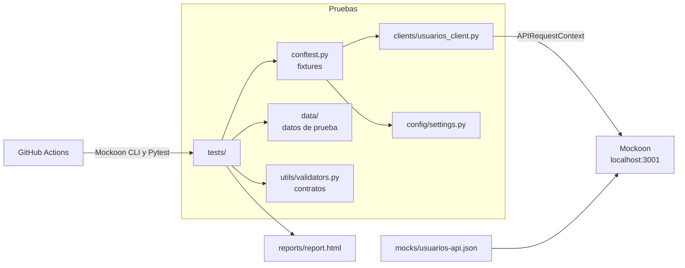

# POC API REST con Playwright, Pytest y Mockoon

Proyecto educativo de automatización de pruebas de API REST. Usa `APIRequestContext` de Playwright para Python, sin navegador, contra una API de usuarios simulada con Mockoon. Los cambios se guardan en memoria mediante data buckets.

## Objetivos

- Practicar pruebas de servicios REST con un cliente reutilizable, fixtures y parametrización.
- Validar flujos CRUD, errores HTTP, timeouts y contratos de respuesta.
- Ejecutar la misma suite en local (Windows 11 y VS Code) y en GitHub Actions.
- Distinguir un timeout del cliente de una respuesta HTTP 504 o 524.

## Tecnologías

| Herramienta | Uso | Versión |
|---|---|---|
| Python | Lenguaje | 3.12 o superior; probado con 3.13 |
| Playwright para Python | Solicitudes HTTP con `APIRequestContext` | 1.64.1 |
| Pytest | Framework de pruebas | 9.2.0 |
| pytest-html | Reporte HTML | 4.2.0 |
| pytest-cov | Cobertura del código Python | 7.1.0 |
| python-dotenv | Variables de entorno | 1.2.4 |
| Mockoon Desktop | Edición visual del mock | Compatible con el formato de datos 33 |
| Mockoon CLI | Ejecución del mock | 9.10.0 |
| GitHub Actions | Integración continua | — |

No hace falta ejecutar `playwright install`: `APIRequestContext` no usa navegadores.

## Arquitectura



## Estructura

```text
.github/workflows/api-tests.yml   Workflow de CI
.vscode/settings.json             Intérprete y detección de pruebas
clients/usuarios_client.py        Cliente REST
config/settings.py                URL base, timeouts y umbrales
data/usuarios.py                  Datos de prueba
mocks/usuarios-api.json           Entorno de Mockoon
reports/                          Reportes generados (no se versionan)
tests/                            Casos de prueba y fixtures
utils/validators.py               Validaciones de contrato
```

Se agregó `data/`, que no estaba en la estructura inicial, para mantener los datos de prueba separados de los casos.

## Requisitos previos

- Windows 11 con PowerShell.
- Python 3.12 o superior.
- Node.js 18 o superior, para Mockoon CLI.
- Visual Studio Code con la extensión Python.
- Mockoon Desktop, opcional, para editar el mock de forma visual.

## Instalación en Windows 11

```powershell
python -m venv .venv
.\.venv\Scripts\Activate.ps1
python -m pip install -r requirements.txt
```

Si PowerShell bloquea la activación, ejecute antes:

```powershell
Set-ExecutionPolicy -Scope Process -ExecutionPolicy RemoteSigned
```

Para cambiar la configuración por defecto, copie el archivo de ejemplo y edítelo:

```powershell
Copy-Item .env.example .env
```

## Configuración de Mockoon

### Con Mockoon CLI

Ejecute esto en una terminal aparte y déjela abierta:

```powershell
npx @mockoon/cli@9.10.0 start --data .\mocks\usuarios-api.json --disable-log-to-file
```

Si PowerShell bloquea `npx`, use `npx.cmd`.

### Con Mockoon Desktop

1. Abra **File > Open local environment** y seleccione `mocks/usuarios-api.json`.
2. Inicie el entorno con el botón de reproducción (**Start/Stop/Reload current environment**). La API queda en `http://localhost:3001`.

Compruebe que responde:

```powershell
Invoke-RestMethod http://localhost:3001/api/usuarios
```

## Endpoints disponibles

| Método | Endpoint | HTTP | Notas |
|---|---|---|---|
| GET | `/api/usuarios` | 200 | Usuarios actuales |
| GET | `/api/usuarios/{id}` | 200, 404 | |
| GET | `/api/usuarios/999` | 404 | Ruta estática |
| GET | `/api/usuarios/lento` | 200 | Retardo de 2000 ms |
| POST | `/api/usuarios` | 201, 400, 422 | Requiere los cuatro campos; el id se genera solo |
| PUT | `/api/usuarios/{id}` | 200, 400, 404, 422 | Requiere los cuatro campos y reemplaza el usuario |
| PATCH | `/api/usuarios/{id}` | 200, 400, 404, 422 | Acepta solo los campos que cambian |
| DELETE | `/api/usuarios/{id}` | 204, 404 | Sin cuerpo ni `Content-Type` |
| GET | `/api/errores/{codigo}` | El indicado | 400, 401, 403, 409, 422, 429, 500, 502, 503, 504 y 524 |

Ejemplo de cuerpo para POST y PUT:

```json
{
  "nombre": "Ana Torres",
  "email": "ana.torres@example.com",
  "rol": "admin",
  "activo": true
}
```

`rol` admite `admin`, `supervisor` o `usuario`, y no se aceptan otros campos, incluido `id`.

Mockoon evalúa las rutas en orden: `lento`, `999` y DELETE deben permanecer antes de la ruta CRUD `/api/usuarios`.

### Persistencia y restablecimiento

Los usuarios viven en el data bucket `usuarios`. Los cambios se ven en las solicitudes siguientes y se pierden al reiniciar Mockoon.

Para volver a los datos iniciales sin reiniciar, por ejemplo desde Postman:

```text
POST http://localhost:3001/api/test/reset
```

Esta ruta existe solo para el laboratorio y no requiere autenticación.

Pytest hace lo mismo antes de cada prueba, así que ejecutar la suite borra los cambios hechos a mano.

Para cambiar el retardo de `/api/usuarios/lento`, modifique `latency` y `retardo_ms` en el mock, y `SLOW_ENDPOINT_DELAY_MS` en `.env`. Una prueba falla si `retardo_ms` y `SLOW_ENDPOINT_DELAY_MS` no coinciden.

## Casos de prueba

| Archivo | Cobertura |
|---|---|
| `test_get_usuarios.py` | Lista, usuario existente y usuario inexistente |
| `test_post_usuarios.py` | Creación y persistencia, caracteres especiales, datos inválidos y payload malformado |
| `test_put_usuarios.py` | Actualización completa y persistencia, usuario inexistente y datos inválidos |
| `test_patch_usuarios.py` | Actualización parcial y persistencia, usuario inexistente y datos inválidos |
| `test_delete_usuarios.py` | 204 sin cuerpo, usuario eliminado, doble eliminación y restablecimiento |
| `test_http_errors.py` | Errores 4xx y 5xx, y encabezados `WWW-Authenticate` y `Retry-After` |
| `test_timeouts.py` | Timeout del cliente frente a respuestas 504 y 524 |
| `test_contracts.py` | Estructura, tipos, valores, campos sensibles y tiempo de respuesta |

### Timeout del cliente, HTTP 504 y HTTP 524

| Situación | Qué ocurre | Cómo se valida |
|---|---|---|
| Timeout del cliente | No llega respuesta dentro del plazo | Playwright lanza `TimeoutError` |
| HTTP 504 | El servidor responde con ese código | `response.status == 504`, sin excepción |
| HTTP 524 simulado | Mockoon responde con ese código | `response.status == 524`, sin excepción |

El código 524 es específico de Cloudflare y no es un código HTTP estándar. Este proyecto solo simula la respuesta, no la infraestructura de Cloudflare.

## Comandos de ejecución

Con Mockoon en marcha:

```powershell
python -m pytest -v                # Toda la suite
python -m pytest -m smoke -v       # También: regression, negative, contract, timeout
python -m pytest tests/test_timeouts.py -v
python -m pytest -k "email" -v
```

Si la API no responde o no es la versión actual del mock, Pytest se detiene con código de salida 3 y un mensaje claro.

## Ejemplos de resultados

Salida real de una ejecución local del 2026-11-05, con Windows 11, Python 3.13.14 y Mockoon CLI 9.10.0:

```text
============================= 106 passed in 7.20s =============================
```

## Generación de reportes

```powershell
python -m pytest -v --html=reports/report.html --self-contained-html
Start-Process .\reports\report.html
```

El reporte muestra las pruebas PASS, FAIL y SKIP, y no se versiona en Git.

Para la cobertura del código Python del framework:

```powershell
python -m pytest --cov=clients --cov=config --cov=utils --cov-report=html
```

El resultado queda en `htmlcov/`. Esta cifra mide el código del framework, no la cobertura de la API.

## Visual Studio Code

1. Abra la carpeta del proyecto.
2. Con `Ctrl+Shift+P`, elija **Python: Select Interpreter** y seleccione `.venv`. `.vscode/settings.json` ya lo propone por defecto.
3. Abra la vista **Testing**: la detección de Pytest ya está configurada sobre `tests/`.
4. Inicie Mockoon antes de ejecutar las pruebas.
5. Para depurar, ponga un punto de interrupción y use **Debug Test** en la prueba.

No agregue `--cov` a `python.testing.pytestArgs`, porque interfiere con los puntos de interrupción.

## Integración CI/CD

`.github/workflows/api-tests.yml` se ejecuta en cada push y pull request:

1. Configura Python y Node.js, e instala las dependencias.
2. Inicia Mockoon CLI con el archivo del repositorio y espera a que la API responda.
3. Ejecuta Pytest con reporte HTML y cobertura.
4. Publica el reporte y el log de Mockoon como artifact `reporte-pruebas`, incluso si hay fallos.
5. El job termina con error si falla alguna prueba.

No necesita Mockoon Desktop ni secretos.

## Limitaciones de las APIs simuladas

- **Persistencia solo en memoria:** los cambios se pierden al reiniciar Mockoon. No hay una base de datos real.
- **Un solo estado compartido:** todos los clientes ven los mismos datos, y ejecutar las pruebas los restablece. No ejecute la suite en paralelo sin aislar los datos.
- **Validación limitada:** los esquemas JSON comprueban la forma de los datos, pero no reglas de negocio como emails duplicados, y el mensaje 422 no indica qué campo falló.
- **Sin fecha de creación:** el modo CRUD no genera campos en el servidor, salvo el id.
- **Contratos propios:** las pruebas validan el contrato definido en este proyecto, no el de un servicio en producción.
- **Tiempos no representativos:** los tiempos de respuesta del mock no sirven como medida de rendimiento.

## Mejoras futuras

- Validar contratos con JSON Schema u OpenAPI.
- Separar el restablecimiento de datos del mock para poder ejecutar la suite contra un entorno real.
- Agregar pruebas de autenticación con tokens.
